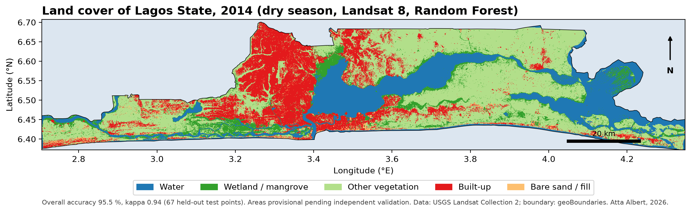

# Land cover of Lagos in 2014 and change to 2025

*Dry-season Landsat 8 composite (November 2013 – March 2014), classified with the same Random Forest method as the 2025 map ([`gee_wetland_change.js`](../gee_wetland_change.js), `YEAR = 2014`). Recorded 26 November 2026. All areas here are raw pixel counts: provisional, not yet for citation.*

## Why 2014 and not 2013

Landsat 8 began routine imaging in April 2013, so the 2013 dry season (November 2012 – March 2013) would depend on Landsat 7 and its scan-line gaps. The 2014 dry season uses the same sensor as the 2025 map, which keeps the comparison fair.

## Training data

The 267 pins placed on the 2025 image were reused after a check. A model trained on the 2025 image classified each pin on the 2014 image, and pins where it disagreed with the label were set aside.

- **71 of 260 pins looked different in 2014.** For example, 18 pins that are bare sand fill in 2025 looked like vegetation in 2014, and 13 built-up pins looked like vegetation or bare ground: land that has changed since 2014.
- **189 stable pins** (water 48, wetland 28, vegetation 75, built-up 28, bare 10) were used for training.
- With only these, wetland and bare land were mapped poorly (wetland producer's accuracy 46 %, bare 0 %). So **49 extra pins** were placed directly on the 2014 image: 25 wetland/mangrove (Badagry creek, Ogun river floodplain, Lekki Conservation Centre, Lekki lagoon) and 24 bare sand (Eko Atlantic fill, harbour beaches, Lekki sand-filled plots, the Lekki Free Trade Zone area).

## Accuracy (2014)

Measured on 30 % of the training points held back from the model (67 points). Because the test points come from the same pins, which were chosen where the class was clear, this is likely optimistic.

| Measure | Value |
|---|---|
| Overall accuracy | **95.5 %** |
| Kappa | **0.94** |

| Class | Producer's accuracy | User's accuracy |
|---|---|---|
| Water | 100 % | 100 % |
| Wetland / mangrove | 85 % | 100 % |
| Other vegetation | 100 % | 83 % |
| Built-up | 100 % | 100 % |
| Bare sand / fill | 100 % | 100 % |

Confusion matrix (rows = reference, columns = map; order water, wetland, vegetation, built-up, bare):
`[[20,0,0,0,0],[0,17,3,0,0],[0,0,15,0,0],[0,0,0,5,0],[0,0,0,0,7]]`

## Change 2014 → 2025 (km², pixel by pixel)

The 2025 map was rebuilt in the same run from the 2025 pins and image (trained on all pins), so both years are compared pixel by pixel. Its class totals differ somewhat from the published 2025 map (for example, built-up 813 vs 935 km²), which shows how sensitive raw areas still are to the training split.

| 2014 ↓ / 2025 → | Water | Wetland | Vegetation | Built-up | Bare / fill | **Total 2014** |
|---|---|---|---|---|---|---|
| **Water** | 572 | 39 | 1 | 5 | 2 | 619 |
| **Wetland** | 27 | 214 | 83 | 27 | 6 | 357 |
| **Vegetation** | 1 | 102 | 1,484 | 127 | 123 | 1,837 |
| **Built-up** | 1 | 3 | 57 | 637 | 139 | 837 |
| **Bare / fill** | 1 | 0 | 9 | 17 | 33 | 60 |
| **Total 2025** | 602 | 358 | 1,634 | 813 | 303 | 3,710 |

## What this shows, and what it does not

1. **About 290 km² became built-up land or sand fill** between 2014 and 2025: 250 km² from vegetation, 33 km² from wetland and 7 km² from water.
2. **About 33 km² of 2014 wetland, roughly 9 %, became built-up land or sand fill.** Wetland, buildings and sand look very different to the satellite, so this conversion is the most trustworthy wetland number here.
3. **Net wetland change cannot be reported yet.** Large areas swap between wetland and vegetation in both directions (83 km² one way, 102 km² the other). That is mostly the two classes being confused, especially in the 2025 map (wetland producer's accuracy 70 %), rather than real change.
4. **Built-up → bare (139 km²)** is also mostly confusion between bright roofs and sand. "Built-up or fill" combined is more reliable than either class alone.
5. Eko Atlantic, the largest single reclamation, is mostly outside the FAO GAUL 2015 boundary used here, so reclamation from the sea is undercounted.

## Figures and data files

- [`data/lagos_landcover_2014.tif`](data/lagos_landcover_2014.tif): the classified 2014 map (GeoTIFF, 30 m, EPSG:4326; same grid and values as the 2025 map. Pixels outside Lagos State are also stored as 0, so clip to the state boundary before use).
- [`data/lagos_class_areas_2014.csv`](data/lagos_class_areas_2014.csv): mapped area per class (km², column `sum`).
- [`data/lagos_accuracy_points_2014.csv`](data/lagos_accuracy_points_2014.csv): the 67 held-out test points.
- [`figures/swipe_2014.png`](figures/swipe_2014.png) and [`figures/swipe_2025.png`](figures/swipe_2025.png): matching 16:9 versions of both maps for a swipe comparison.
- Figures are drawn with [`tools/make_landcover_figure.py`](../tools/make_landcover_figure.py), masked with the Lagos State outline from geoBoundaries.

## Next steps

1. Check the "Wetland 2014 → built-up or sand by 2025" layer visually in a few places (Lekki–Ajah corridor, Ibeju-Lekki).
2. An independent stratified random sample to estimate change areas with confidence intervals (Olofsson et al. 2014), focusing on the wetland → built-up / fill class.
3. A boundary that includes new coastal land (Eko Atlantic).
4. The 2000 and 1986 maps.
